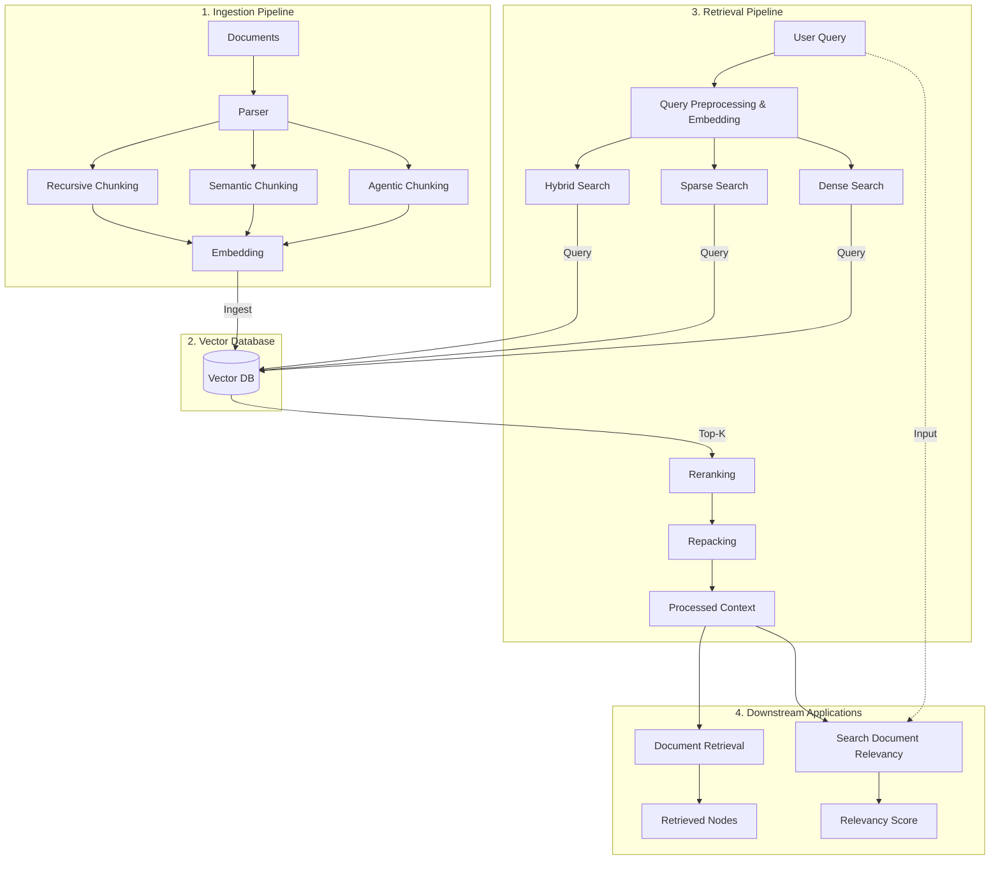
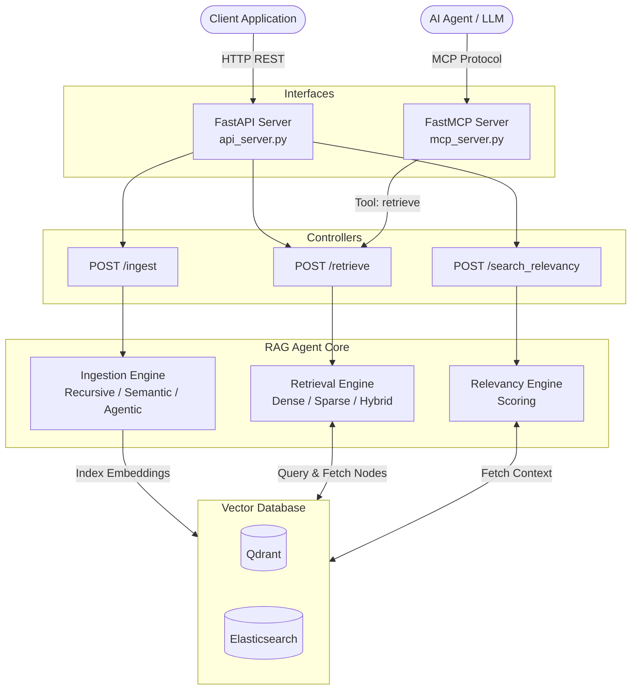

# Retrieved-Augmented Generation (RAG) Backbone

A highly scalable and modular Retrieval-Augmented Generation (RAG) backbone utilizing Large Language Models (LLMs) and vector databases for various downstream applications, including document question-answering, document search, and relevancy scoring.

## 🧠 RAG Algorithm Architecture

The underlying RAG pipeline consists of three main stages: Ingestion, Retrieval (including Reranking & Repacking), and Downstream Applications.



## ⚙️ System Architecture

The overall system architecture demonstrates how external clients and AI agents interact with the RAG Backbone via APIs and the Model Context Protocol (MCP).


## 🏗 Architecture & Features

The RAG system is built with a modular architecture and supports both standard REST APIs and Model Context Protocol (MCP).

### 🧩 Core Components
- **Agent (`agent/`)**: Contains the core orchestration logic for the RAG workflows.
  - **Ingestion**: Parses documents (like PDFs and TXT files) and chunks them. Supports multiple advanced chunking strategies: `recursive`, `semantic`, and `agentic`.
  - **Retrieval**: Fetches relevant information nodes and documents leveraging dense, sparse, or hybrid retrieval methods. Supports multi-collection querying and metadata filtering.
  - **Search Relevancy**: Evaluates and scores document relevancy based on the user's query.
- **Controllers (`controller/`)**: Exposes the system capabilities via RESTful FastAPI endpoints (`/ingest`, `/retrieve`, `/search_relevancy`).
- **Vector Database (`vector_db/`)**: Abstracted vector storage layer currently supporting **Qdrant** and **Elasticsearch**.
- **Interfaces**:
  - **FastAPI Server** (`api_server.py`): Standard REST API for broad application integration.
  - **FastMCP Server** (`mcp_server.py`): Model Context Protocol server, enabling native integration with AI agents like Claude Desktop.

## 🚀 Installation

### 1. Clone the repository
```bash
git clone https://git.capax-tech.com/paul_tsoi/rag_backbone.git
cd rag_backbone
```

### 2. Set up a virtual environment
Using `venv` (Python standard library):
```bash
python -m venv venv
source venv/bin/activate  # Windows: venv\Scripts\activate
```
Using `conda` (Recommended Python 3.11):
```bash
conda create --name rag_env python=3.11
conda activate rag_env
```

### 3. Install dependencies
```bash
pip install -r requirements.txt
```

### 4. Configuration
Copy the environment variables example and configure it according to your LLM and Vector DB setup:
```bash
cp .env.example .env
```

## 🐳 Quick Start (Docker)

The easiest way to get started with the Qdrant vector store and the RAG servers is via Docker Compose:

```bash
docker compose up -d --build
```
This command spins up:
- **Qdrant Vector Database** on port `6333`
- **FastAPI REST Server** on port `8008`
- **FastMCP Server** on port `8009`

## 💻 Usage

### 1. Document Ingestion (Python SDK)
You can directly use the RAGAgent within your Python codebase:

```python
from agent.core import RAGAgent

if __name__ == "__main__":
    rag_agent = RAGAgent()
    rag_agent.folder_ingestion(
        folder_path="data/superlinear", # Path to your data directory
        collection_name="super_linear", # Name of the target collection
        mode=["agentic", "semantic", "recursive"], # Chunking modes
    )
```

### 2. Document Ingestion (REST API)
Using the FastAPI server, you can ingest files via HTTP POST requests:

```python
import requests
import json

BASE_URL = "http://127.0.0.1:8008"
api_url = f"{BASE_URL}/ingest"

file_paths = ["file_1.txt", "file_2.pdf"]
files = [("files", open(path, "rb")) for path in file_paths]

metadata = {
    "collection_name": "super_linear_2",
    "mode": ["recursive", "semantic", "agentic"],
}

response = requests.post(
    api_url, 
    files=files, 
    data={"metadata": json.dumps(metadata)}
)
print("Response:", response.json())
```

### 3. Document Retrieval & Search (REST API)
The FastAPI server exposes retrieval endpoints for querying your knowledge base:
- `POST /retrieve`: Retrieves context nodes and documents based on the query, collections, and metadata.
- `POST /search`: Calculates and returns document relevancy scores based on the query.

### 4. Agentic Integration (MCP)
The RAG backbone includes an MCP server (`mcp_server.py`) which exposes a `retrieve` tool. You can integrate this with MCP-compatible clients (like Claude Desktop) to allow your AI assistants to dynamically query your indexed documents.
